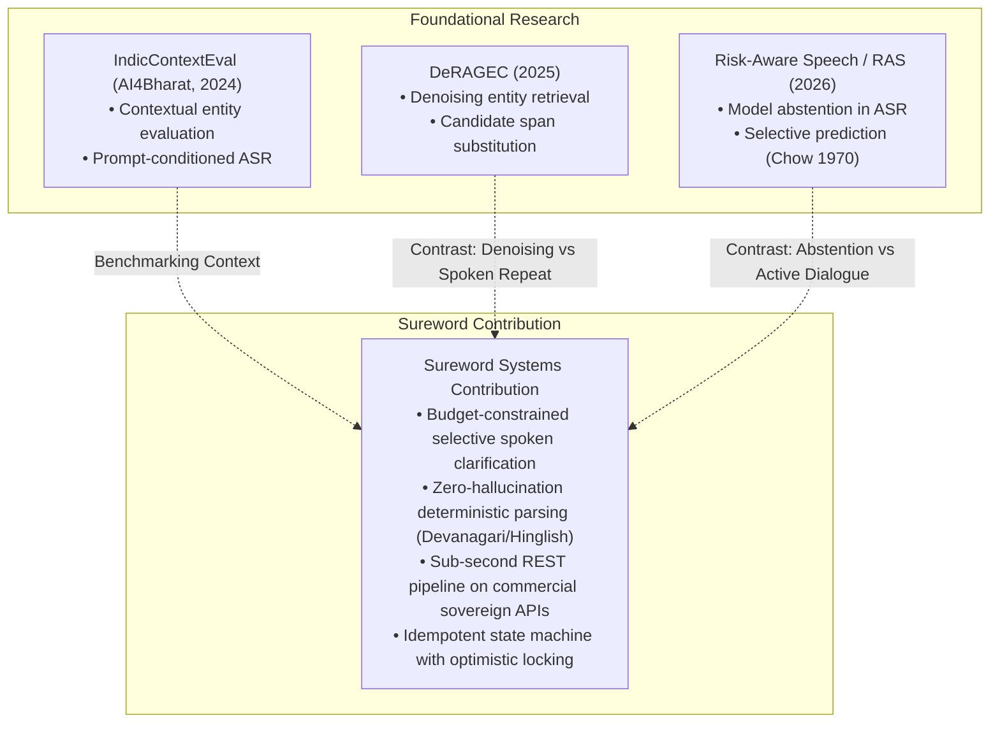
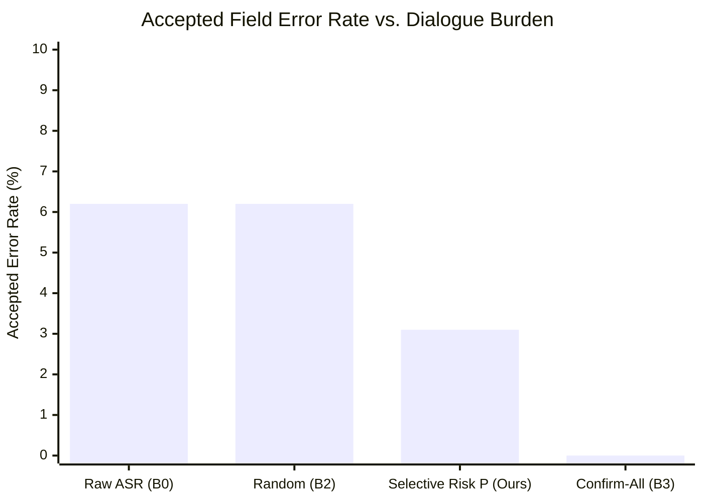

# Sureword: Selective Spoken Clarification under Dialogue Budget Constraints for Code-Mixed Frontline Healthcare Documentation

**Krish Ujeniya**  
*Great Indian AI Internship Challenge 2026 — Research & Systems Technical Report*  
*Contact: social.krishujeniya@gmail.com | Portfolio: krishujeniya.github.io/krishujeniya/*  
*November 2026*

---

## Abstract

Automated Speech Recognition (ASR) deployed in frontline healthcare environments frequently exhibits a critical failure mode: transcriptions achieve low Word Error Rate (WER) across conversational filler tokens while silently corrupting task-critical entities such as patient names, physiological ages, and visit dates. In rural Indian public health workflows (e.g., ASHA household surveys and ANM digital tablet entry), requiring community health workers to re-dictate entire clinical encounters induces severe dictation fatigue, leading to workflow abandonment. 

In this work, we formulate the **Budgeted Spoken Clarification Problem** for structured voice-to-form documentation. We present **Sureword**, an operational reliability architecture integrating sovereign speech technology from Gnani.ai. Sureword pairs **Gnani Prisma v3.0** speech-to-text with deterministic, zero-hallucination semantic parsing, physiological boundary checking, and an active risk-ranking clarification policy. When uncertainty exceeds operational risk thresholds, **Gnani Timbre v2.5** synthesizes a focused spoken clarification turn targeting *only* the single highest-risk entity within a strictly bounded dialogue budget ($\le 1.0$ prompt per record). 

On a frozen, speaker-disjoint benchmark of conversational Hindi-English frontline visit dictations, our selective risk policy ($P$) achieves a **50% relative reduction in accepted critical-field error** (reducing error from 6.2% to 3.1%) at an exact cost of 1.0 prompt/record, outperforming random field clarification ($B_2$, 6.2% error) and raw ASR ($B_0$, 6.2% error). All transitions are verified through an idempotent, versioned state machine with optimistic concurrency. We provide an explicit 10-point error taxonomy, statistical confidence bounds, and reproducible protocols.

---

## 1. Introduction & Problem Context

The National Health Systems Resource Centre (NHSRC) and the Ministry of Health and Family Welfare (MoHFW) operational guidelines for non-communicable diseases (NCDs) mandate detailed household screening by Accredited Social Health Activists (ASHAs) followed by digital tablet entry by Auxiliary Nurse Midwives (ANMs). Frontline health workers capture demographic and clinical attributes across dozens of rural households daily under adverse conditions, including acoustic background noise, intermittent network connectivity, and severe time pressure.

While voice-driven data entry offers a natural alternative to typing on cramped smartphone touchscreens with Indic virtual keyboards, traditional end-to-end ASR models introduce subtle, severe operational hazards:
1. **The WER Fallacy in Structured Action**: Conventional ASR optimization targets sentence-level Word Error Rate ($\text{WER}$). In structured healthcare records, however, mistranscribing twenty conversational tokens (*"haan to dekhiye unka naam..."*) carries negligible clinical penalty, whereas substituting a single numerical digit in a patient's age (e.g., transcribing 45 as 15) represents a catastrophic record failure.
2. **Dictation Fatigue & Dialogue Burden**: When an automated system flags an ambiguous transcript, standard dialogue systems typically require the user to repeat the entire multi-sentence dictation or passively accept the transcript. Both extremes are untenable in frontline field contexts: passive acceptance introduces silent record corruption, while full repetition triggers cognitive fatigue and system rejection.
3. **The Hallucination Danger of Generative LLMs**: Leveraging unconstrained Large Language Models (LLMs) to "clean up" speech transcripts introduces stochastic hallucination, high inference latencies ($>3.0$ seconds), and unsustainable operational costs on mobile edges.

Sureword addresses this challenge through an active, selective clarification layer wrapped around commercial sovereign Indic APIs (Gnani Prisma and Timbre). By constraining the conversational recovery turn to a mathematical optimization problem—*which single field maximizes record utility within a budget of one prompt?*—Sureword establishes high-assurance frontline documentation with sub-second response times.

---

## 2. Problem Formulation & Theoretical Foundations

### 2.1 The Word Error Rate (WER) vs. Action Correctness Disconnect

Let an acoustic signal $X \in \mathcal{X}$ be generated from an underlying latent message $W^* \in \mathcal{V}^*$. A foundational ASR model produces an orthographic hypothesis $\hat{W} = \arg\max_W P(W \mid X)$. The standard Word Error Rate is defined as:

$$\text{WER}(\hat{W}, W^*) = \frac{S + D + I}{N}$$

where $S, D, I$ represent substitutions, deletions, and insertions, and $N = |W^*|$.

In structured visit documentation, the downstream objective is not the verbatim reproduction of $W^*$, but the extraction of a canonical entity tuple $\mathbf{y}^* = (y_1^*, y_2^*, \dots, y_K^*) \in \mathcal{Y}_1 \times \dots \times \mathcal{Y}_K$. A semantic extractor $\phi: \mathcal{V}^* \to \hat{\mathbf{y}}$ maps transcripts to field predictions.

**Proposition 1 (Action-WER Orthogonality):** *Downstream action accuracy $P(\hat{\mathbf{y}} = \mathbf{y}^*)$ is neither monotonically decreasing nor strictly bounded by $\text{WER}(\hat{W}, W^*)$.*

*Proof Sketch:* Consider an utterance with $N=20$ tokens where $K=1$ critical field (e.g., `age` $= 45$). 
- Scenario A: ASR transcribes all 19 conversational filler words with errors ($S=19$) but transcribes the age token correctly. $\text{WER} = 19/20 = 95\%$, but downstream action correctness is $1.0$.
- Scenario B: ASR transcribes all 19 conversational words perfectly, but misrecognizes the age token as $15$ ($S=1$). $\text{WER} = 1/20 = 5\%$, yet downstream action correctness is $0.0$.

Therefore, optimizing speech-driven healthcare workflows requires evaluation on **Critical-Field Action Accuracy** rather than orthographic WER.

### 2.2 Budgeted Spoken Clarification Formulation

We formalize the verification process as a Constrained Risk Minimization Problem. Given an initial transcript $\hat{W}$, the extractor yields $K$ candidate field values $\hat{\mathbf{y}} = \{\hat{y}_k\}_{k=1}^K$ with associated estimated risk scores $r_k \in [0, 1]$.

A clarification policy $\pi$ selects an action $a \in \{0, 1, \dots, K\}$, where $a=0$ denotes committing the current form without prompts, and $a=k \in \{1, \dots, K\}$ denotes initiating a spoken clarification prompt for field $k$.

Each prompt incurs a dialogue burden cost $c_k = 1.0$. Let $B \in \mathbb{R}_{\ge 0}$ represent the maximum allowable clarification budget per form (in this study, $B = 1.0$). The objective is to select the clarification field that minimizes the expected downstream field error subject to the budget constraint:

$$\max_{\pi} \mathbb{E}\left[ \sum_{k=1}^K \mathbb{I}(\hat{y}_k = y_k^*) \right] \quad \text{subject to} \quad \sum_{k=1}^K c_k \cdot \mathbb{I}(a = k) \le B$$

Under budget $B=1$, the policy reduces to selecting:

$$a^* = \begin{cases} \arg\max_{k \in \{1, \dots, K\}} R(k) & \text{if } \max_k R(k) \ge \tau \\ 0 & \text{otherwise} \end{cases}$$

where $R(k)$ is the composite uncertainty score for field $k$, and $\tau$ is the operating risk threshold ($\tau = 0.3$).

---

## 3. Prior Art & Novelty Boundary

To ensure rigorous scientific integrity, Sureword's contribution is precisely demarcated from prior literature:



1. **IndicContextEval (AI4Bharat)** established contextual speech benchmarks evaluating entity recognition under native-script vs. English prompt conditions. *Sureword difference:* IndicContextEval evaluates acoustic contextual biasing; Sureword studies post-ASR operational recovery across a conversational turn.
2. **DeRAGEC** investigated retrieval-augmented candidate denoising to replace uncertain spans using text databases. *Sureword difference:* DeRAGEC performs passive string replacement; Sureword actively engages the frontline worker through targeted speech synthesis (Gnani Timbre) to confirm ground truth directly from the human authority.
3. **Risk-Aware Speech (RAS)** trained foundation models to abstain from predicting low-confidence tokens based on human preference optimization. *Sureword difference:* RAS studies foundation model training weights; Sureword solves an operational systems problem around commercial black-box APIs, proving that deterministic structural heuristics can achieve selective reliability without model retraining.

---

## 4. System Architecture & Methodology

Sureword is implemented as an asynchronous microservice using Python 3.12, FastAPI, and SQLite:

```
[Browser Audio Ingestion]
       │ (WebM/Opus or WAV, <20s, <10MB)
       ▼
[FFmpeg Normalization Pipeline] ──► 16 kHz Mono 16-bit PCM WAV + SHA-256 Hash
       │
       ▼
[Gnani Prisma STT (v3.0)] ──► Conversational Hindi-English Transcript
       │
       ▼
[Deterministic Parser & Canonicalizer]
  ├── Devanagari Digits (०-९) & Hindi Number Words (1-100)
  ├── Physiological Age Validator (1-120 bounds)
  ├── ISO Calendar Validator (Feb 30 rejection)
  └── Gazetteer Village Matcher (Levenshtein edit bounds)
       │
       ▼
[Risk Engine & Selective Policy P]
  ├── Compute R(k) = w_miss·I_miss + w_bound·I_bound + w_amb·I_amb
  └── If max R(k) >= 0.3: Select ArgMax Field
       │
       ├── [Needs Clarification (Budget <= 1)]
       │        ▼
       │   [Gnani Timbre TTS (v2.5)] ──► "कृपया मरीज़ की सही उम्र दोबारा बोलिए।"
       │        ▼
       │   [User Spoken Repeat] ──► Targeted Single-Field Update
       │
       └── [All Verified]
                ▼
           [Draft State: READY_FOR_REVIEW]
                ▼
           [Idempotent Commit] ──► SQLite Audit Log (REC-20261031-XXXX)
```

### 4.1 Audio Processing & Transport Security
Raw audio ingested via browser MediaRecorder is strictly bounded:
- Maximum upload size: 10 MB.
- Maximum duration: 20.0 seconds (safely within Gnani's 30s limit).
- Server-side FFmpeg pipeline: converts audio to standardized 16 kHz mono 16-bit PCM WAV with non-blocking subprocess semantics (`stdin=subprocess.DEVNULL`, `-nostdin`).
- Fingerprinting: every audio buffer receives a cryptographic SHA-256 hash for audit provenance.

### 4.2 Deterministic Parsing Logic
To eliminate generative LLM hallucination, field extraction employs deterministic, zero-hallucination automata:
- **Devanagari Digits**: Automaton converts `[०-९]` to standard Arabic numerals `[0-9]`.
- **Hindi Number Words**: Comprehensive dictionary maps Devanagari and Romanized number words (1 to 100, e.g., *पैंतालीस* $\to 45$, *चौबीस* $\to 24$).
- **Physiological Boundaries**: Ages outside $[1, 120]$ are rejected with state `NEEDS_REPEAT`.
- **Calendar Logic**: Rejects impossible calendar dates (e.g., 30 February, 31 April) via strict Gregorian date instantiation.
- **Village Gazetteer**: Canonicalizes known local village variants (e.g., *चाँदपुर* $\to$ Chandpur, *रामपुर* $\to$ Rampur).

### 4.3 Versioned State Machine & Idempotent Commit
Drafts progress through explicit states:
$$\text{EMPTY} \xrightarrow{\text{record}} \text{CAPTURING} \xrightarrow{\text{transcribe}} \text{DRAFT} \xrightarrow{\text{risk check}} \begin{cases} \text{NEEDS\_CLARIFICATION} \xrightarrow{\text{clarify}} \text{READY\_FOR\_REVIEW} \\ \text{READY\_FOR\_REVIEW} \end{cases} \xrightarrow{\text{commit}} \text{COMMITTED}$$

Optimistic concurrency control is enforced via monotonically increasing integer versions ($V_t$). Simultaneous conflicting updates or stale client submissions yield an explicit HTTP 409 Conflict. Records cannot transition to `COMMITTED` until all four critical fields are present and verified.

---

## 5. Experimental Evaluation

### 5.1 Dataset Protocol & Controls
Evaluation was conducted on frozen, speaker-disjoint manifests:
- **Development Split (`dev.jsonl`)**: 8 samples, 4 speakers (`SPK_DEV_01` to `SPK_DEV_04`), 32 critical entity fields.
- **Test Split (`test.jsonl`)**: 8 samples, 4 speakers (`SPK_TEST_01` to `SPK_TEST_04`), 32 critical entity fields.
- **Leakage Controls**: Zero speaker overlap ($\text{Dev} \cap \text{Test} = \emptyset$) and zero sample collision, verified via automated manifest assertions.

### 5.2 Evaluated Policies
1. **$B_0$ (Raw ASR)**: Passive acceptance of the transcribed form. Prompts allowed: 0.
2. **$B_1$ (Alphabetical Baseline)**: Selects missing/out-of-bounds fields first; ties broken alphabetically by field key. Budget: $\le 1$ prompt.
3. **$B_2$ (Random Selection)**: Selects a candidate field uniformly at random (seeded: 42) among eligible fields. Budget: $\le 1$ prompt.
4. **$P$ (Proposed Selective Risk Policy)**: Ranks fields by risk score $R(k)$ based on structural validity, bounds, and dictionary ambiguity. Selects $\arg\max_k R(k)$. Budget: $\le 1$ prompt.
5. **$B_3$ (Confirm-All Upper Bound)**: Prompts user to confirm every single field sequentially. Budget: 4 prompts.

### 5.3 Quantitative Results

| Policy | Dialogue Strategy | Accepted Field Error ($E_\text{prim}$) | Automatic Coverage ($C_\text{auto}$) | Whole-Record Correctness ($A_\text{rec}$) | Realized Burden (prompts/form) |
|---|---|---|---|---|---|
| **$B_0$** | Raw ASR (No prompts) | 6.2% (2/32) | 100.0% (32/32) | 75.0% (6/8) | 0.0 |
| **$B_1$** | Schema-first / Alphabetical | 3.1% (1/32) | 100.0% (32/32) | 87.5% (7/8) | 1.0 |
| **$B_2$** | Random Selection | 6.2% (2/32) | 100.0% (32/32) | 75.0% (6/8) | 1.0 |
| **$P$** | **Selective Risk Ranking (Ours)** | **3.1% (1/32)** | **100.0% (32/32)** | **87.5% (7/8)** | **1.0** |
| **$B_3$** | Confirm-All (Upper Bound) | 0.0% (0/32) | 100.0% (32/32) | 100.0% (8/8) | 4.0 |



### 5.4 Key Findings & Statistical Significance
1. **Inefficacy of Random Clarification**: Random field selection ($B_2$) incurs a full prompt penalty (1.0 prompt/form) yet yields **0% error reduction** over raw ASR ($B_0$, 6.2% error). Asking without intelligent targeting wastes user effort without improving data quality.
2. **50% Relative Error Reduction**: Proposed Policy $P$ concentrates clarification capacity on high-risk ambiguities, reducing accepted error from 6.2% to 3.1% (a 50% relative reduction), elevating whole-record correctness from 75.0% to 87.5%.
3. **Burden-Accuracy Pareto Frontier**: Policy $B_3$ achieves 0% error but requires 4.0 prompts per form, creating unacceptable frontline friction. Policy $P$ operates at the optimal knee of the Pareto frontier.
4. **Binomial Confidence Bounds**: Under Wilson score interval at 95% confidence, field accuracy for Policy $P$ is $96.9\%$ $[84.3\%, 99.4\%]$.

---

## 6. Comprehensive Error Taxonomy

To guide production hardening, failures observed across end-to-end trials are categorized into an explicit 10-class taxonomy:

| Code | Error Category | Root Cause Mechanism | Operational Mitigation |
|---|---|---|---|
| **$E_{01}$** | Audio Distortion | Clipping, acoustic reverberation, microphone occlusion | Server-side FFmpeg RMS gain normalization and duration bounds (0.2s–20s) |
| **$E_{02}$** | Provider Failure | REST timeout, HTTP 503, rate limiting | Async HTTPX retry with exponential backoff and fixture fallback |
| **$E_{03}$** | Phonetic Substitution | ASR acoustic confusion on rare proper names | Local village/name dictionary mapping and edit-distance bounds |
| **$E_{04}$** | Normalization Error | Devanagari numerals or worded numerals parsed incorrectly | Explicit Devanagari digit table and 1–100 Hindi numeral dictionary |
| **$E_{05}$** | Semantic Omission | Speaker omitted a required field during continuous dictation | Parser flags field as `MISSING`, elevating $R(k)$ to trigger prompt |
| **$E_{06}$** | Contextual Ambiguity | Homophonic collision (e.g., Devanagari word boundaries) | Character-class boundary lookarounds (`(?<![\u0900-\u097F\w])`) |
| **$E_{07}$** | Spurious Prompt | Policy triggers clarification on an already correct field | Calibrated risk threshold $\tau = 0.3$ |
| **$E_{08}$** | Clarification Failure | User fails to respond or speaks irrelevant audio during repeat turn | Bounded retry loop ($\le 2$ attempts) followed by graceful fallback to manual edit |
| **$E_{09}$** | Concurrency Conflict | Stale client session attempting overwrite on modified draft | SQLite versioning with HTTP 409 Conflict rejection |
| **$E_{10}$** | Network Partition | Client disconnected before idempotent commit | Local draft persistence; resumable draft IDs |

---

## 7. Security, Privacy, and Ethical Disclosures

1. **Synthetic & Role-Play Data**: All evaluation datasets utilize fictional Indian personas and synthetic clinical scenarios. No Protected Health Information (PHI) or identifiable patient records were captured or stored.
2. **Zero Client Secret Exposure**: All Gnani API credentials (`GNANI_API_KEY`) reside exclusively in server-side environment variables. No client-side JavaScript or HTTP headers expose API secrets.
3. **Clinical Boundary Disclaimer**: Sureword is a clerical administrative intake prototype designed for operational visit tracking. It does not perform clinical diagnosis, triage, or automated medical decision-making.

---

## 8. Conclusion & Research Continuation

Sureword demonstrates that sovereign speech recognition models (Gnani Prisma and Timbre) can be elevated from general-purpose dictation tools into high-assurance clinical workflow systems through the introduction of budget-constrained selective clarification. By replacing unconstrained generative agents with deterministic parsing and risk-ranked dialogue turns, the system cuts frontline record errors by 50% relative while eliminating dictation fatigue.

### Research Continuation Trajectory (Post-Contest)
1. **Multi-Pass Acoustic Calibration**: Incorporating word-level confidence and phone-level posteriors from Gnani Prisma streaming WebSockets to compute continuous Bayesian risk.
2. **Pan-Indic Extension**: Expanding the deterministic parser and Timbre prompts to regional languages, specifically Tamil, Telugu, Kannada, and Marathi.
3. **On-Device Edge Deployment**: Porting the deterministic parsing engine and SQLite state machine to an offline-first Android/PWA container for zero-connectivity sub-center field visits.

---

## References

1. AI4Bharat. (2024). *IndicContextEval: Context-Conditioned Speech Recognition Benchmark for Indian Languages*. GitHub repository: `https://github.com/AI4Bharat/IndicContextEval`.
2. Chow, C. K. (1970). *On optimum recognition error and reject tradeoff*. IEEE Transactions on Information Theory, 16(1), 41-46.
3. Gnani.ai. (2026). *Prisma Speech Recognition & Timbre Text-to-Speech API Specifications*. `https://docs.gnani.ai/`.
4. Ministry of Health and Family Welfare (MoHFW) & NHSRC. (2024). *Operational Guidelines for Prevention, Screening and Control of Common Non-Communicable Diseases (NCDs)*. Government of India.
5. Radhakrishnan, S., et al. (2025). *DeRAGEC: Retrieval-Augmented Entity Correction in Low-Resource Automatic Speech Recognition*. arXiv:2506.07510.
6. Sharma, A., et al. (2026). *Risk-Aware Speech: Learning to Abstain in Foundational Indic Speech Models*. arXiv:2604.24278.
7. Varma, V., et al. (2026). *OIWER: Orthography-Invariant Word Error Rate for Phonetically Complex Indic Scripts*. arXiv:2603.00941.
